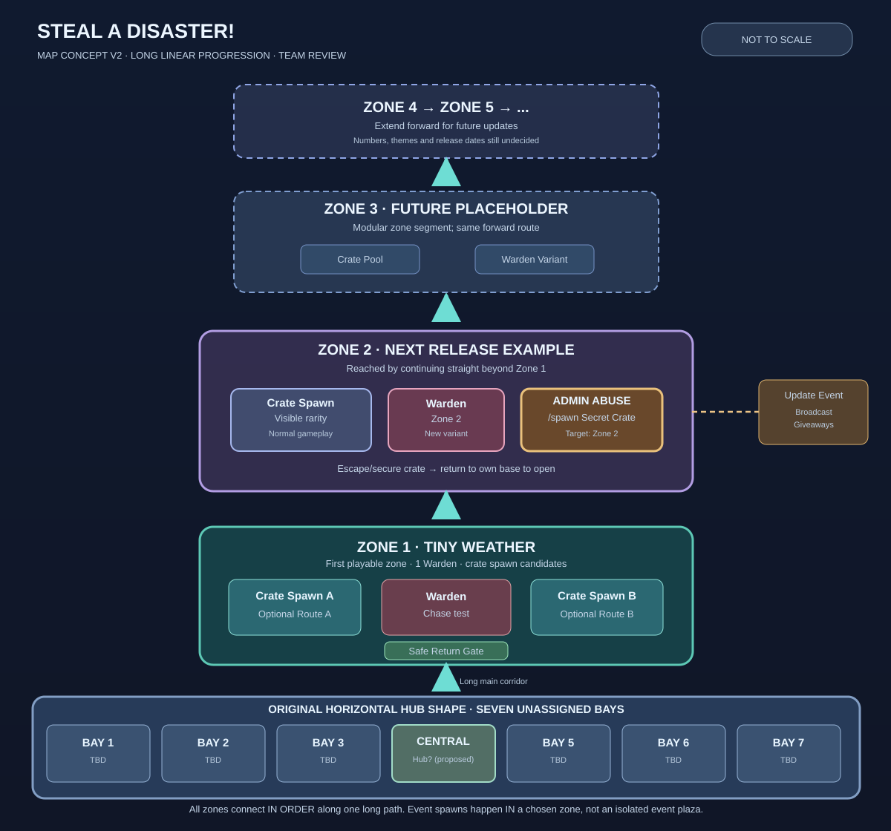

# Steal a Disaster! — Map Concept v2: Continuous Linear Zones (TEAM REVIEW)

**Status:** The Head explicitly confirmed on 2026-10-13 that Zones extend in a **single long sequence: Zone 1 → Zone 2 → Zone 3 → ...**. This supersedes the old v1 proposal for west/east branch portals, a separate event plaza and a bounded two-Zone layout. The precise hub arrangement, base count, dimensions and safe-return mechanics are **not yet approved**. This is **design only**, not a Roblox Studio build.



[Open the full-sized SVG](assets/map-concept-v2.svg) — the diagram matches the Head-confirmed long sequential Zone layout.

## 1. Layout direction — confirmed vs proposed

**Confirmed by Head:** One long, continuous route extends forward through **Zone 1 → Zone 2 → Zone 3 → ...**, with newer Zones appended at the far end as they are released. Players can progress through the world physically along that sequence. **Do not turn this into a branching Zone selection lobby/portal network.**

**Retained from the user's original sketch:** a wide horizontal starting area with **seven internal rectangles** and a narrow upward-running route from the center. **The seven rectangles have never been confirmed to mean seven player plots.** Bay labels 1–7 remain placeholders; placing training/Index/Trail Shop in the center Bay is a **proposal**, not a confirmed instruction.

```text
                ...  new Zones keep extending upward
                             |
                          [ZONE 4+]
                             |
                     [ZONE 3 (future)]
                             |
              [ZONE 2: crates + Warden]
                  [EVENT: admin /spawn]
                             |
               [ZONE 1: starter crates]
                   [Warden + 2 routes]
                             |
                       [SAFE RETURN]
                             |
                 [LONG MAIN ACCESS]
                             |
   [B1] [B2] [B3] [CENTRAL?] [B5] [B6] [B7]
             wide horizontal initial area
```

The diagram reads bottom-to-top from the Hub; each new Zone continues the same **forward corridor**. Its exact length, terrain, entrances, exit checkpoints and geometry require Studio greybox tests. The first prototype still only needs **one actual Zone**, not a fully built Zone 2+.

## 2. Zone segments and expansion contract

| Component | Status | Design intent |
| --- | --- | --- |
| Horizontal start area and seven Bays | Original user sketch, **Bay function unconfirmed** | Player bases, training and services to be assigned **after Head review**. Every base needs its own crate-opening station. |
| Central upward route | **Confirmed linear direction** | A legible corridor from the initial area into Zone 1, then **Zone 2 directly beyond it**, then subsequent Zones in order. |
| Zone 1 — Tiny Weather | First playable scope; detailed design **proposed** | Easy initial crate spawns, one Warden, experimental Stabilize/Snatch, optional two escape paths and a readable safe exit. |
| Zone 2 | **Future segment example, not implemented** | Continues beyond Zone 1, can contain higher-tier crates and a different Warden config. Its content, title and entry requirements are undecided. |
| Zone 3+ | **Expansion direction confirmed** | Add further segments to the end of the route without remaking Zones 1/2 or the starting Hub. No fixed number of Zones or guaranteed Zone-per-week policy. |
| Admin Abuse / Special Crate Spawn | **GLOBAL, in-zone event direction confirmed** | An authorized **global** spawn event targets Zone 2 (example Secret Crate): **each active server** creates its own event crate at an approved Zone 2 node with an announcement. No isolated Event Plaza, no player-specific Spawn Event Boost, and no one shared cross-server crate. |
| Long-distance return assistance | **Design question** | Decide whether later Zones use a safe return lane, checkpoints, unlockable shortcuts or transport. Preserve the forward line of Zones while avoiding frustrating trips back to the player's own base. Nothing chosen yet. |

**Per-Zone implementation proposal:** Each new `ZoneId` has data-defined forward/back access anchors, spawn node IDs, crate rarity pool, Warden variants, signage and optional event spawn nodes. A **zone append** changes only the next segment plus configs; it should not need to restructure the main base/hub or copy the full crate-opening system.

## 3. Real player experience (core design retained)

1. At a plot/base, the player can train Speed Power and see the next Zone requirement (exact gating still undecided).
2. The player proceeds **through Zones in world order** to the currently reachable Zone. A crate of visible rarity spawns at a candidate position and an NPC Warden guards it.
3. The player chooses **Stabilize** (slower, lower escape instability) or **Snatch** (fast, more instability); Warden chase and the crate's telegraphed effect create an escape decision.
4. A captured crate is **not revealed in the Zone**. The player must escape and return to **their own base** to open it and get one random Disaster from that crate rarity pool.
5. Special event crate spawns occur **in a specified existing Zone**; a Secret Crate in Zone 2 is the Head's example. Their spawn and reward values are not yet decided.

**Prototype requirement:** Confirm that Zone 1 can be completed easily by a new player and the route home is readable. Do not force an overlong walk, an unavoidable guard trap or a single campable choke point.

## 4. Weekly updates and in-zone Admin Abuse

**Confirmed direction:** Target one game update each week, and organize engaging developer-led **Admin Abuse** sessions with giveaways / controlled special spawns. A new Zone may be a major update theme; weekly updates do **not automatically require a new Zone**.

**Head-confirmed update:** When new Zone 2 launches, an authorized admin may trigger a **GLOBAL Secret Crate Spawn targeting Zone 2** and distribute event rewards. This should fan out to **all active game servers**, with each server spawning **its own Secret Crate** in Zone 2; it is not a normal spawn-rate/luck boost for a single player. Exact command syntax, crate count, Zone eligibility, timing, spawn intervals and giveaway economy remain undecided.

A safe design should support:
- **Global, Zone-targeted event commands/config:** one authorized event requests a specified crate tier and target `ZoneId` **across all active servers**; each server resolves approved local spawn nodes and shows the same event announcement. A unique `EventId` plus expiry/dedupe is needed to avoid repeated claims and to let new servers catch up during the event (mechanism to be implemented and validated).
- **Server-enforced authority and caps:** Only approved staff may invoke in-zone event spawns/grants; log the actor, Zone, item/tier, time, quantities, expiry and outcome. Reject invalid/locked Zone ids and unbounded rewards.
- **Player experience:** A special spawn must be recognizable and fair to reach. If an event targets Zone 2, decide how players who have not unlocked it can participate, if at all; this is still an **open design decision**.
- **World stability:** Admin Abuse should not block the ordinary linear route, trap players, invalidate existing crates or bypass anti-duplication/economy protections.
- **Weekly content operations:** Release/new segment when ready → staging QA → Head publish approval → broadcast event/new crate spawns/giveaways → monitor economy/latency. No guarantee that a brand-new Zone ships every week.

No actual privileged commands are implemented or authorized for live use by this map document.

## 5. Greybox scope and acceptance

**Not yet authorized to implement.** After Head and teammate review, Stage A is proposed as a small local/staging-place test:

- One wide starting footprint and **one temporary test plot** with a crate opener; do not assign all seven Bays.
- One long central access path and **Zone 1 only**, with one Warden, candidate crate spawn points, two optional escape routes and one clear safe return boundary.
- A **placeholder forward connection** to future Zone 2, without detailed Zone 2 terrain/art.
- Test a full run: take visible-tier crate → escape → return along the linear route → open at the player's own base. Check solo/mobile and Warden reset.
- Confirm the performance and travel/return time before deciding the distance between Zones, adding a Zone 2 segment or adopting any shortcut mechanism.
- Review how to place an **in-zone Secret crate event spawn marker** in Zone 2 when that Zone is actually implemented; don't stage a production admin-giveaway system inside the greybox.

Do **not** build west/east portal wings or a dedicated Event Plaza based on the superseded Map Concept v1.

## 6. Decisions still to review with three-person team

1. **Head:** What are the seven rectangles in the starting area meant to represent, and should the middle one contain training/services?
2. **All:** As the corridor length grows, what is a fair way to return valuable crates to your own base without skipping the actual Warden escape?
3. **All:** How do Zone requirements and safe entry/exit boundaries work when Zones connect directly and a player carries a crate back through earlier territory?
4. **All:** How should an update's **Zone 2 Secret Crate** event communicate availability, and can lower-progress players join the event?
5. **Map teammate:** Evaluate two escape route shapes **inside each Zone**, rather than adding unrelated world branches.
6. **Head:** Approve/revise this linear layout before building any live Studio map.

## 7. Documents and tasks

- [Game Vision v0.6](GAME_VISION.md) — agreed gameplay mechanics, tiers and weekly Admin Abuse direction
- [Zone 1 map task — Issue #3](https://github.com/NutthakitPatike/Steal-a-Disaster-/issues/3)
- [Weekly events and giveaway design — Issue #7](https://github.com/NutthakitPatike/Steal-a-Disaster-/issues/7)

**Change control:** This v2 corrects the Map Concept v1 PR rather than approving a real Studio map. It preserves only confirmed direction and marks remaining choices for team review.
