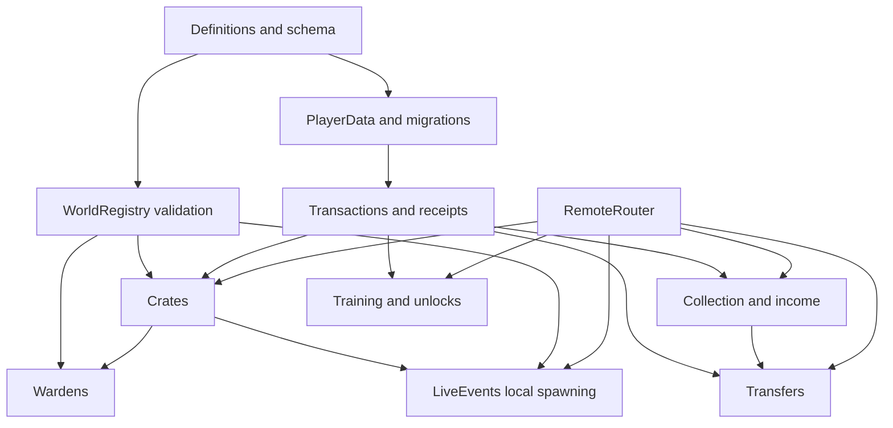

# Technical architecture and data contracts

Status PROPOSED. These are interface specifications, not implemented modules. Prefer ordinary Luau modules and direct calls. No service framework, generic event bus, dependency container or custom ECS is required.

## 1. Authority and ownership

Choose classic Roblox character replication for the initial implementation, with server-authoritative gameplay state and server movement checks. This is distinct from Roblox's opt-in Server Authority physics mode. Do not claim the latter is enabled or silently migrate to it. P1-02 records the chosen configuration and validates it in staging.

Client owns presentation and input intent only. Server owns profile readiness, inventory, Coins, spawn/rarity rolls, capture timers, base ownership, path eligibility, training accrual, Warden targets/catches and admin authorization. The server derives price, reward, duration, zone and tier from validated IDs. ProximityPrompt is an input affordance, not a trust boundary; its client properties do not establish valid interaction. [Roblox client/server security guidance](https://create.roblox.com/docs/scripting/security/client-server-boundary).

Logical state must not depend on whether a streamed model exists on a client. Instance attributes are presentation and authored configuration inputs, never a client-writable authority for economy.

## 2. Proposed module and Studio map

Keep the existing `src/server`, `src/client`, `src/shared` split and `default.project.json` compatibility. Create modules only when the owning task needs them.

| Proposed file | Studio location / owner / responsibility |
|---|---|
| `src/server/Bootstrap.server.luau` | ServerScriptService.Server.Bootstrap; sequential startup, readiness, shutdown |
| `src/server/WorldRegistry.luau` | Discover/validate authored tagged anchors and WorldContract version |
| `src/server/PlayerData.luau` | Session ownership, migrations, durable snapshots, command serialization |
| `src/server/ProfileSchema.luau` | Pure validation/default/migration functions |
| `src/server/Transactions.luau` | Profile operations and receipts, checked arithmetic, economy settlement |
| `src/server/EconomyDefinitions.luau` | Server prices/rates/caps/config version |
| `src/server/LootDefinitions.luau` | Versioned pools and validated weighted rolls |
| `src/server/Crates.luau` | Spawn, reservation, pickup, carry, safe exit, banking/open orchestration |
| `src/server/Wardens.luau` | AI state, navigation, catch validation, cleanup |
| `src/server/Collection.luau` | Inventory, placement, Index, sell/fuse; one mutation path through Transactions |
| `src/server/Progression.luau` | Treadmill occupancy, power, upgrades, trails, zone access |
| `src/server/Transfers.luau` | P2 only; durable theft escrow and ownership reconciliation |
| `src/server/LiveEvents.luau` | P4 only; authorization, registry, waves, dedupe, audit |
| `src/server/Telemetry.luau` | Bounded metrics/event adapter; gameplay does not wait on logging |
| `src/server/RemoteRouter.luau` | Parse schemas, limits, request dispatch, structured responses |
| `src/shared/Definitions.luau` | Stable IDs, public catalog descriptions and DTO types; no authoritative mutable tables |
| `src/shared/UIDefinitions.luau` | UI tokens/string keys; public only |
| `src/client/Bootstrap.client.luau` | Bound startup, state snapshot and controller cleanup |
| `src/client/HUDController.luau` | HUD/capture/carry/saving feedback |
| `src/client/CollectionController.luau` | Inventory, details, placement preview, Index |
| `src/client/ProgressionController.luau` | Treadmill input, upgrades, shops, trails |
| `src/client/EventController.luau` | Event display and local cosmetic effects |
| `src/client/UIComponents.luau` | Shared buttons, modal, grid, notifications; split only if size requires |
| `tests/runtime/*.spec.luau` | Future pure/state tests and isolated Studio test runner |
| `studio/exports/<task>-<zone>.rbxmx` | Authored scoped world/model exports, reviewed with source changes |

Author original assets under `ServerStorage.Assets` until needed, replicated lightweight visual templates under `ReplicatedStorage.Visuals`, and the authored map under `Workspace.DisasterWorld`. Adopt current map via a reviewed adapter rather than generating a fresh world on every boot. Tags/attributes identify `BaseId`, `ZoneId`, `SpawnNodeId`, `ExitId`, `ServiceId`, `WorldContractVersion`. IDs, not display names, form the contract. Validate duplicate IDs before enabling gameplay.

Current `TornadoTownPrototype.server.luau` and HUD remain as disabled test references only during transition. P1-08 retires their startup path after every caller switches; never run both prototype and production owners for the same world. `PrototypeWorld`/`ZoneMap` remain isolated test-scene helpers if useful, never silently overwrite authored production assets.

## 3. Dependency and startup order



Bootstrap loads and validates static definitions, validates critical map anchors, creates remotes, starts profile lifecycle, then binds gameplay and finally marks server ready. `require` bodies do not start yielding work. New players remain Loading until their own session is ready. Missing optional Trails visuals use fallback; a missing safe exit disables that Zone and alerts the server log. Missing Zone1/base schema fails readiness rather than creating a replacement map.

Each module owns its connections, tasks and instances. `Destroy()` or `Stop()` cancels timers and disconnects listeners. Player scope tears down on leaving; character scope tears down on CharacterRemoving/respawn. Bind an already-present character as well as future CharacterAdded. A generation token makes delayed callbacks harmless after ownership changes.

## 4. Public operation signatures

Names below are the contract between tasks. Luau types are specification notation.

| Operation | Inputs | Result / invariant |
|---|---|---|
| `PlayerData.Load(userId)` | Server-derived userId | Ready session or explicit failure; no temporary writable default |
| `PlayerData.Transact(userId, operationId, expectedRevision, operation)` | Validated server operation | `Receipt` after durable critical commit; serialized per profile |
| `PlayerData.Close(userId)` | Owned session | Drain pending writes, release lease; never promise unlimited shutdown time |
| `WorldRegistry.Resolve(kind, id)` | Allowlisted kind and ID | Validated server anchor or MissingAnchor |
| `Crates.BeginCapture(player, crateId, method)` | Method Stabilize/Snatch | Reservation or carry state; validates clock/LOS |
| `Crates.CancelCapture(player, reservationId)` | Player's reservation | Idempotent cancellation |
| `Crates.TrySecure(player, exitId)` | Server-observed crossing | Durable ReturnPending or pending/error |
| `Crates.Bank(player, crateId)` | Own-base proximity | Banked crate receipt with hidden outcome stored |
| `Crates.Open(player, crateId, operationId)` | Banked ID | One Disaster grant; stable receipt |
| `Collection.Place/Store(player, disasterId, slotId?, operationId)` | Valid owned item/version | Slot state and profile revision |
| `Collection.Collect(player, operationId)` | Own terminal proximity | Wallet delta and remaining stored milli-Coins |
| `Collection.Sell/Fuse(player, ids, operationId)` | One or three distinct stored IDs | Atomic consume and payout/output |
| `Progression.SetRunIntent(player, machineId, isRunning, sequence)` | Bounded input hint | No direct gain result; sampled server accrual |
| `Progression.Purchase(player, productId, quoteVersion, operationId)` | Allowlisted catalog ID | Debit+entitlement receipt |
| `Transfers.Begin/Reclaim/Deposit(player, disasterId, operationId)` | Server eligibility and target | Durable escrow outcome, not a client-selected new owner |
| `LiveEvents.Schedule(actor, templateId, zoneId, operationId)` | Authorized actor and fixed template | Event descriptor after durable write |

Feature modules call Transactions; they do not separately modify the wallet/inventory. Pure functions for curves, weighted pools, recipes and state transitions support unit tests. Runtime adapters resolve player identity and geometry.

## 5. Remote contracts

Use reliable `RemoteEvent` request/response and state-delta channels. No `RemoteFunction` is needed for a slow save or admin operation. Snapshot request returns asynchronously. Never use server `InvokeClient` to authorize a grant. Cosmetic VFX may later use unreliable events but are not necessary for the first implementation.

Common request envelope is `{protocol=1, requestId, expectedRevision, action, payload}`. `requestId` is a bounded ASCII UUID-like string≤64bytes, scoped to authenticated player. Reject oversized/unknown fields, tables deeper than3, nonfinite numbers, invalid UTF-8, more than3 itemIds and arbitrary Instances/CFrames. Action-specific parsers produce internal types. Limit request payload≤2KB. Strings for IDs≤64bytes. Do not trust supplied UserId, price, elapsed time, income or reward.

| Action | Payload | Additional server checks | Initial per-player limit |
|---|---|---|---|
| Snapshot | empty | Ready or loading-only response | 1/sec burst2 |
| CaptureBegin | crateId, method | alive, Zone owned, distance≤10, LOS, free carry, valid crate | 2/sec burst4 |
| CaptureCancel | reservationId | owned reservation | 4/sec burst4 |
| Bank/Open | crateId | correct state, own base≤8, cap/slot reservation | 2/sec burst2 |
| Place/Store | disasterId, slotId forPlace | ownitem/slot, state, own base≤8 | 4/sec burst6 |
| Collect | empty | ownterminal≤8, settled income | 1/sec burst2 |
| Sell/Fuse | itemIds | shop≤8, stored/unlocked/notreserved, recipe | 1/sec burst2 |
| Purchase | productId, quoteVersion | station≤8, balance/prereqs/version | 1/sec burst2 |
| EquipTrail/LockItem | itemId ortrailId, boolean whenneeded | ownership/state | 2/sec burst4 |
| RunIntent | machineId, running, sequence | discard outoforder; sample occupancy server-side | 10/sec burst15 |
| TheftBegin/Reclaim/Deposit | disasterId | shield/timer/LOS/distance/escrow | 2/sec burst3 |
| AdminSchedule/Cancel | templateId,zoneId orEventId | UserIdrole server allowlist, global cooldown, config version | 1/5sec burst1 |

Global request bucket30/sec burst45 protects parse/dispatch work. Valid rate does not waive validation. Limits are hypotheses to tune under7-player tests. Return codes include `NotReady`, `OutOfRange`, `Busy`, `RateLimited`, `StaleRevision`, `InventoryFull`, `InsufficientCoins`, `SavePending`, `DataUnavailable`, `Forbidden`, `AlreadyApplied`. Retries use the same requestId and query receipt state. A rejected command changes nothing.

Response is `{requestId, status, code?, revision, result?}`. Profile state channel carries `{revision, changes}` and a full snapshot after gaps. Remote/property replication ordering is not assumed. Public replication includes placed catalog/owner information, not hidden banked outcomes, session tokens, admin allowlists or transfer internals.

## 6. Persistent schema and invariants

The following is a schema sketch, not a Lua implementation.

```text
Profile v1
  schemaVersion, revision, contentVersion
  coins: integer [0,1e9]
  speedPowerMilli: integer [0,1e7]
  upgrades: {treadmill:0..3, pen:0..3, slots:4|6|8}
  unlockedZones: set<ZoneId>; successfulDeliveries: map<ZoneId,int>
  ownedTrails: set<TrailId>; equippedTrail: TrailId
  items: map<DisasterId,{speciesId,rank:1..3,variantId,originZone,
         acquiredAt,locked,slotId?,itemVersion,transferTracked:boolean}>
  bankedCrates: map<CrateId,{zoneId,tier,lootVersion,hiddenSpeciesId,
         hiddenVariantId,reservedItemId,bankOperationId}>
  returnPending: optional {crateId,zoneId,tier,lootVersion,exitId,
         checkpointVersion,secureOperationId}
  storedIncomeMilli, incomeRemainder, lastCheckpointAt
  index: set<SpeciesId>; indexBonusClaimed: set<ZoneId>
  tutorialStep, activePlaySeconds, shieldUntil, shieldCooldownUntil
  receipts: bounded recent operation results
  pendingTransfers: map<TransferId,{role,itemId,phase}>
  pendingItemOperations: map<OperationId,{kind,inputIds,operationRecordId}>
  eventClaims: active/recent EventId -> set<claimId>
  session metadata: ownerJobId, fencingToken, leaseExpiry
```

Inventory cap includes placed items and reserved future slots for all banked/return-pending crates. A carry slot reservation prevents filling the inventory while a trip is in progress. `DisasterId` and `CrateId` are generated server-side and globally unique; server-local counters alone cannot identify persistent items. Derive opened item ID from the persisted crate grant identity, and fused item ID from the operation identity.

Invariant set: Coins never negative; item in at most one slot; slot belongs to current baseowner; every usable item has exactlyone owner; consumed items never act; one carry/player; one reservation/crate; one profile writer/session; every committed Open has exactlyone output; income paused for escrowitem; all values serializable and bounded.

Use a profile budget≤256KB as an initial guard, checked before commit. Keep at most128 recent general receipts and retain nonterminal operations separately. Receipt eviction must not re-enable operations: consumed crate/item IDs are no longer valid command targets, entitlements are monotonic, and transfer/event tombstones retain the durable identity needed for their replay windows. Never rely only on a short receipt cache for a permanent grant.

## 7. Durability and failure protocol

Use Roblox DataStore `UpdateAsync` through a small PlayerData adapter, with a reviewed session implementation. Do not scatter raw datastore calls through services. `UpdateAsync` may retry callbacks; callbacks must be pure, non-yielding and free of RNG, instance creation or messages. Session ownership and a fencing token reject writes from a stale server. Roblox documents session locking to prevent overlapping profiles and rollback duplication. [Player data systems](https://create.roblox.com/docs/cloud-services/data-stores/player-data-purchasing), [GlobalDataStore reference](https://create.roblox.com/docs/reference/engine/classes/GlobalDataStore).

Recommended implementation choice for P1-03 is a narrowly reviewed UpdateAsync adapter with explicit tests, **not** a broad persistence framework. A maintained session wrapper can replace the adapter only after its current API/license and failure behavior are checked; the rest of the game uses the same PlayerData contract. Do not select an uninspected library solely by reputation.

Critical mutations use a provisional snapshot, validate it, commit snapshot+receipt atomically in the profile key, then swap live authoritative state and ACK. Block conflicting mutations while pending, but keep the character responsive where safe. Unexpected timeout is ambiguous, not necessarily failure; inspect owned-session state with the same operation identity before refund/retry. No “subtract then hope to add later” operation.

Candidate lease is120s, renew every30s, fencing generation increments on ownership changes. Do not seize a lease before expiry. If renewal fails, stop writes before local expiry with a safety margin; the final write callback also checks ownership, so clock assumptions alone cannot admit a stale writer. Shutdown drains pending operations within platform limits and releases ownership. Periodic saves bound loss; shutdown hooks cannot guarantee a save after a hard process crash.

Committed inventory/Coins must survive the tested failure cases. Uncommitted training/passive accrual can lose up to the30s checkpoint interval; UI and QA distinguish that from an acknowledged purchase/grant. A load failure never creates a writable empty default. A confirmed absent key creates the default inside the owned session transaction. Unsupported newer schema fails closed. Migration copies old data, applies each version step, validates and commits with version increment once. Retain a staging backup/version and rehearse rollback on test keys only.

Death/disconnect before safe-exit commit loses the unsecured crate. After commit, `returnPending` restores at the corresponding safe-exit recovery marker, never at home. When banking, persist the prepared hidden outcome and reservedItemId in the same replacement of `returnPending`. Opening removes Banked and adds its outcome in one profile transaction. Rejoin cannot reroll a Banked crate or skip carrying it home.

## 8. Cross-player theft cannot use a single-profile shortcut

Roblox profiles are separate keys; this plan does **not** assume multi-key atomic transactions. `Transfers` is a bounded escrow saga, restricted initially to two Ready players in the same server. Ordinary trades are excluded.

Use one durable ownership record `ItemTransfer/<disasterId>` once an item enters theft. It contains currentOwner, generation, item descriptor, state, transferId, candidateOwner, expiry and terminal receipt/tombstone. The canonical record decides ownership while profiles are projections. A transferred item keeps `transferTracked=true`; future sell/fuse/theft operations must validate and settle through that record. A consumed record remains a tombstone. Do not erase that flag after a successful theft.

Protocol:

1. Acquire the local item lock and both profile command slots in ascending UserId order; timeout instead of deadlocking. Settle income. Durably mark the victim item reserved with a pendingTransfer pointer whose ID is derived from the item and generation.
2. Create/update canonical escrow only if currentOwner/generation agrees. If the server dies between step1 and2, victim reconciliation sees its pointer with no valid escrow and restores the item. Do not remove the victim item yet.
3. Durably record the thief's incoming pointer and reserve capacity. Only after both profiles can discover the transfer may the theft carry start. Client visuals never confer ownership.
4. On catch, timeout, pre-commit disconnect or invalid route, write Cancelled/currentOwner=victim in the canonical record, then reconcile both profiles and resume income. A racing cancellation and deposit compare the same generation; one wins.
5. At valid own-base deposit, atomically change the canonical record to Committed/currentOwner=thief using the transferId and expected generation. This is the ownership linearization point. From this moment the victim's stale projection is unusable.
6. Idempotently remove the victim projection and insert the thief projection with the same disasterId and nextitemVersion. Both projections remain unavailable until they reconcile the terminal record. ACK and show success after durable reconciliation, or show Transfer pending if recovery is needed.
7. Keep nonterminal pointers across disconnects. On join, resolve all pointers before Ready. Repeated reads use persisted state; no minting from a missing/ambiguous record. Only garbage-collect terminal pointer metadata after both projection acknowledgements, while retaining canonical ownership/tombstone.

Hold local command mutexes only during each bounded prepare/commit/cancel step, never throughout the 45-second carry. Durable item/capacity reservations preserve the exclusion between steps. Unrelated profile operations can proceed, but must reject reserved items and account for reserved slots/fees. Reacquire locks in the same order for the next transition and verify the generation again.

For a later sale/fusion of a transfer-tracked item, first durably add a `pendingItemOperations` pointer to the owning profile before any canonical item consumption. Create `ItemOperation/<operationId>` in Prepared state with exact inputs, fixed payout/output identity and reserved Coin fee. Acquire ordered per-item reservations and validate owner/generation. If any reservation fails, cancel and restore all reservations without charging. Only the operation record's Committed transition authorizes irreversible consumption and the fixed result. Reconciliation marks inputs consumed and applies the output/payout/fee once to the profile, then records acknowledgement. A crash before the operation record exists restores the profile reservation; a crash after Committed must finish it. This discovery pointer prevents a sold item becoming consumed with no way to recover its payout on rejoin.

For fusion, the operation lists all three inputs, including ordinary and transfer-tracked items, and preserves one committed result identity. Profile command serialization and item reservations prevent concurrent sale/theft while it is pending. Test the mixed-input case, not only three tracked items. This receives its own P2-06 fault matrix. If it cannot meet the gate, launch is blocked until fixed or Head explicitly approves a scope amendment; do not silently disable a required management operation.

Victim disconnect cancels an uncommitted raid. This allows defensive disconnecting, a conscious initial fairness tradeoff. Log it and reassess after playtests. A committed theft never rolls back just because either player leaves. No live release until every failure boundary proves one usable owner and eventual reconciliation. This applies the **Make Operations Idempotent** principle, specifically changing Open, transfer and Event design from best-effort duplicate checks to persisted identity plus reconciliation.

## 9. Global event architecture

`MessagingService` delivery is best effort, not guaranteed. Use it as a prompt to read canonical state, not as the only event record. [MessagingService reference](https://create.roblox.com/docs/reference/engine/classes/MessagingService).

Canonical durable registry contains one current descriptor `{eventId,revision,templateId,zoneId,startsAt,endsAt,lootVersion,waveInterval=60,waves=5,cratesPerWave=2,cancelled,actorUserId,createdAt,minBuildVersion}`. Durable operationId prevents an admin retry creating a second event. Server validates allowlist/role and global cooldown before registry update. Fixed template caps supersede client arguments.

Each participating server subscribes, reads at boot and polls canonical registry every15s with jitter while budget permits. A MemoryStore cache/short coordinator lease is optional acceleration, never the only record or sole authority for earned rewards. MemoryStore is temporary storage, unsuitable as the only permanent reward ledger. [Memory stores](https://create.roblox.com/docs/cloud-services/memory-stores).

For the current wave, local instance keys are `eventId:waveIndex:slotIndex:jobId`. Keep local scheduled/spawned/claimed states so repeated notifications cannot respawn a claimed slot in the same job. A restarted job joins only the current wave, not all missed historical waves. If no valid node is free, defer within the wave; skip at waveexpiry. Max activeeventcrates2/Zone. Despawn unclaimed crates whenevent ends; earned durable return/banked crates remain valid.

Per-player claims use a globally unique claimId persisted in that player's profile at safe-exit commit, with max10/EventId. Notify limit before capture where possible; enforce again atcommit. Profile sessions prevent server-hop dualwrites. A rejected claim gives no item and releases eventcarry safely. Retain claimsets until eventexpiry plus7days; old expiredEventIds are rejected independently of retained receipts.

Participation means compatible build, valid targetZone and successful registry access. Healthyservers should reconcile within30s, measured in two-server tests. An outage can prevent delivery, so no design can honestly promise simultaneous all-server execution regardless of Roblox service availability. Detect/report lagging status and skip expired waves; do not silently replace missing event delivery with unlimited coins.

Admin audit records include actor, role, requestId, eventId, config version, zone, quantities, timestamps and success/failure/cancel outcome. If durable registry/audit preparation fails, fail closed before broadcast. Cancel stops future spawns and expires unclaimed crates; it does not delete earned inventories.

## 10. Physical treadmill control

Use a visible belt platform with one reserved runner position. Players walk onto it normally and hold forward input; there is no interaction button that directly increases Power. Qualification requires the character already standing inside its oriented bounds, feet raycast to the belt and facing within 30 degrees of belt-forward for 0.5 s.

Choose a server-owned run-in-place mode for the first version. Anchor HumanoidRootPart at its already-valid position during Training, without teleporting onto the machine, while the avatar's run cycle and belt texture move at the training cadence. This keeps a stationary real treadmill usable without requiring large world displacement. Input is continuously held, not a toggle that earns forever. The visual run animation does not authorize gain.

On forward release, Jump, lateral/backward intent, death, stale intent for 0.5 s, machine removal or session teardown, stop accrual and restore the root's prior Anchored state and normal locomotion. Never anchor a character that was already anchored for another system. The server must implement all cleanup paths, including errors during entry. The client predicts only animation/UI and sends bounded intent/sequence values. Its Stop action remains visible on touch.

The server owns the occupancy reservation, verifies the belt has not moved away, samples grounded/alive/Ready state and credits capped elapsed time. Forged held input from an avatar on the belt can imitate continuous training; the design does not claim to prove human input. It still cannot increase the configured rate, earn outside the belt or skip progression. This limitation is acceptable for launch and must not be described as complete bot detection.

P2-01 tests animation, control release and camera comfort on actual mobile before accepting this mode. If it feels unresponsive, revise the locomotion design in a reviewed contract change; never compensate by trusting client-reported distance or gain.

## 11. Performance, monitoring and security operations

Use one bounded Warden scheduler (5Hz decisions, ≤1pathrequest/sec/NPC), one income settlement function per affected profile, and one treadmill occupancy sampler5Hz. Avoid hundreds of per-item connections or per-frame network messages. Cosmetic animations run locally with distance/quality gating. Every repeating loop has cancellation and workcaps.

Track livecounts of crates, reservations, carried items, Wardens, listeners/tasks, pending writes, saves/retries/latency, active leases, transferage, event delivery lag and remote rejections. Track gameplay funnel using server-confirmed `joined_ready`, `capture_started`, `capture_method`, `escaped`, `banked`, `opened`, `placed`, `collected`, `trained`, `zone_unlocked`, `theft_started/resolved`, `event_claimed`. Telemetry failure must not abort gameplay transactions.

Movement validation uses server-observed history, elapsed time and allowed speed plus measured latency tolerance. Validate ordered zone checkpoints, legal exit direction/volume, LOS and minimum plausible elapsed route time; do not trust WalkSpeed alone. On a suspect jump, withhold irreversible deposit until revalidated and log evidence. Do not permanently ban based on one lag spike. Keep exact thresholds in a server definition and test highlatency against malicious teleports.

Asset import never executes unreviewed reference code. No secrets in Shared or client source. Admin identities live server-side. Production DataStore access and publish are explicit Head actions. Error messages return safe codes to clients while internal logs retain diagnostic detail without tokens or sensitive profile dumps.
