# Steal a Disaster! implementation plan P1–P4

> For agentic workers: after Head approves this plan, use the installed execution-planning workflow to implement one task at a time. Read the matching Roblox domain skill in that runtime. Skill availability on this computer is not proof of teammate availability. Do not start implementation from this document alone.

**Goal:** Deliver the locked physical carry-and-return collection game with seven bases, five launch Zones and safe server-local instances of a global event.

**Architecture:** Studio-first targeted edits with exported, reviewed source and models. Server-authoritative state, profile transactions and explicit recovery own all durable outcomes. No framework or whole-Place regeneration is required.

**Tech stack:** Roblox Studio, Luau, native UI, DataStoreService, PathfindingService, MessagingService; MemoryStore only if justified. Git/PRs version every accepted source/asset handoff. Rojo is optional and never writes alongside MCP.

**Spec:** [Master index](README.md), [GDD](02-game-design.md), [economy](03-content-economy.md), [world/UI](04-world-ui.md), [architecture](05-architecture.md), [quality gates](07-quality-launch.md).

## Global constraints

P1 Core Gameplay → P2 Progression & Gameplay Systems → P3 Map & Environment → P4 Admin Abuse & Live Events. Physical carrying and return remain mandatory. Seven bases and five named sequential launch Zones are fixed. Zone6–7 and bosses are not launch work. Do not edit production DataStores or publish without Head approval. No concurrent writers to a Studio object or managed script. Every task has one owner, scoped paths/Zone, reviewer and evidence.

## Review focus

- Ambiguous save timeout must not refund or grant twice. P1-03/P1-06 test commit-with-lost-ACK.
- Movement/Prompt spoofing must not skip Stabilize or return. P1-04/P2-01 test held-time and physical occupancy.
- A transfer can crash after only one profile write. P2-05/P2-06 test every durable boundary including future sale/fusion.
- A streamed model can disappear while logical ownership remains. P3-08 tests stream-out during carry and interactions.
- Global notification can be missing or duplicated. P4-02/P4-04 test polling convergence, expiry and replay.

## How to read tasks and execute them

Task IDs are permanent. Phase/milestone/epic group the work; each task title is the feature. Numbered Implementation actions are its subtasks. Existing State describes the audited baseline, not the result after dependencies. A task is not complete until its tests and acceptance criteria have evidence at the reviewed revision.

For code tasks, first encode the stated failure case as a failing test, implement the smallest behavior, rerun that test and its integration path, then prepare a reviewed PR. Art tasks use blockout, authored export, Studio playthrough and visual/performance evidence. Do not create tests that only search source strings to prove runtime behavior. New runtime test files below are planned artifacts, not existing tests or commands already run.

Task completion record must include owner, branch/HEAD, Studio identity, exact files/objects, before/after source hashes, test command/scenario, result, evidence paths, reviewer and unresolved defects. Assign human names/GitHub accounts before starting; role labels below are proposals.

## Milestones, MVP and dependency order

| Phase | Milestones / release level | Required result |
|---|---|---|
| P1 | M1.1 Foundation, M1.2 full loop, M1.3 internal MVP | Zone1 +7bases, unique inventory, placement/income, tested saves and physical return |
| P2 | M2.1 progression, M2.2 theft, M2.3 beta gate | Physical treadmill, all management/progression systems, safe theft and measured economy |
| P3 | M3.1 world foundation, M3.2 five biomes, M3.3 quality gate | Three-Zone closed-beta art checkpoint during M3.2, then five finished Zones/20species/productionUI |
| P4 | M4.1 control, M4.2 experience/recovery, M4.3 launch decision | Authorized global events with local crates, catch-up and release operations |

A Phase closes only after its gate. Later production work does not begin before the previous Phase gate; references, concept sketches and estimates can be prepared earlier without claiming that work complete. P1's navigation blockout is the minimum needed to test gameplay, not a reordered P3 art production phase.

```mermaid
flowchart LR
  A[P1-01 baseline] --> B[P1-02 contracts]
  B --> C[P1-03 persistence]
  C --> D[P1-04 capture/carry]
  D --> E[P1-05 Warden]
  E --> F[P1-06 opening]
  F --> G[P1-07 income]
  G --> H[P1-08 MVP gate]
  H --> I[P2 training/upgrades/management]
  I --> J[P2-05 escrow]
  J --> K[P2-06 theft]
  K --> L[P2-07 balance and P2-08 gate]
  L --> M[P3 world and content]
  M --> N[P3-08 quality gate]
  N --> O[P4 registry/sync/waves]
  O --> P[P4 recovery and launch gate]
```



Critical path is persistence → capture/return → bank/open → placement/income → transfer correctness → progression acceptance → world/art production → performance → cross-server recovery → release gate. Content art can become the longest path; recalculate from actual task throughput after two sprints.

Within a Phase, Dev3 can build UI against frozen DTOs while Dev2 implements servers; Head authors scoped anchors and runs acceptance. P3-06 character production and P3-03…05 world art can run in parallel after P3-02, provided different people own the assets. P3-07 cannot overlap P3-06 on the same Dev3 capacity without extending duration. A dependency graph permits work; it does not create extra people.

## Task catalog

### P1-01. Baseline, ownership and Studio reconciliation

- [ ] Implement and verify this task after its dependencies pass.

| Field | Task contract |
|---|---|
| Task ID | P1-01 |
| Title | Baseline, ownership and Studio reconciliation |
| Phase / milestone / epic | P1 / M1.1 Foundation / E1 Safe workspace |
| Objective | Establish one staging target and recoverable starting state. |
| Priority | P0 |
| Dependencies | None |
| Existing State | PARTIAL: source8/disk8/live4 at audit |
| Owner / reviewer | Head / Dev2 |
| Implementation / subtasks | 1. Record approved decisions, exact PlaceId/GameId, branch/HEAD and per-script source hashes before any edit. 2. Save a user-visible backup of current unsaved Studio state after authorization to implement; compare all eight files and map roots. 3. Select intended staging map and reconcile only missing/different assigned objects. 4. Read back sources/hierarchy and record receipts; confirm lnwjud route or explicit fallback. |
| Files / Modules | docs/DECISIONS.md; docs/STUDIO_MCP.md; docs/GAME_VISION.md; docs/TASK_BACKLOG.md; studio/exports/<baseline>.rbxmx; no gameplay changes yet |
| Risks | Wrong place, unsaved state overwritten, dual writer. |
| Tests | Before/after source hashes and hierarchy; reopen backup in separate staging copy; verify source8 and map anchors; verify actual device/tool access. |
| Acceptance Criteria | One named human owns each scope; correct staging place and complete source/tree confirmed without lost preexisting objects. |
| Deliverables | Baseline manifest, backup path, source/scene diff, task ownership and documented Studio-first workflow. |
| Estimated Effort | 2–3 person-days, including targeted tests and review fixes; assumptions below |

### P1-02. World, remote and state contracts

- [ ] Implement and verify this task after its dependencies pass.

| Field | Task contract |
|---|---|
| Task ID | P1-02 |
| Title | World, remote and state contracts |
| Phase / milestone / epic | P1 / M1.1 Foundation / E1 Safe workspace |
| Objective | Freeze minimal cross-team interfaces. |
| Priority | P0 |
| Dependencies | P1-01 |
| Existing State | MISSING target contracts |
| Owner / reviewer | Dev2 / Head |
| Implementation / subtasks | 1. Add failing schema/invalid-request tests. 2. Define IDs, DTOs, result codes, state enums and authority model from05. 3. Implement WorldRegistry validation and bounded RemoteRouter parser with request buckets. 4. Bind one harmless snapshot request and fail readiness for missing critical anchors. |
| Files / Modules | src/shared/Definitions.luau; src/server/WorldRegistry.luau; src/server/RemoteRouter.luau; tests/runtime/Contracts.spec.luau |
| Risks | Clients depend on unstable names; accidentally trusting attributes. |
| Tests | NaN/Infinity/invalidUTF8/unknown action/oversized table; duplicate anchor IDs; snapshot revision gaps. |
| Acceptance Criteria | Rejected requests mutate nothing; catalog and WorldContract validate; Head approves interfaces. |
| Deliverables | Typed contract table, schema tests, source and staging readback. |
| Estimated Effort | 2–4 person-days, including targeted tests and review fixes; assumptions below |

### P1-03. Profiles, durable transactions and recovery

- [ ] Implement and verify this task after its dependencies pass.

| Field | Task contract |
|---|---|
| Task ID | P1-03 |
| Title | Profiles, durable transactions and recovery |
| Phase / milestone / epic | P1 / M1.1 Foundation / E2 Durable data |
| Objective | Own each profile once and commit critical mutations safely. |
| Priority | P0 |
| Dependencies | P1-02 |
| Existing State | MISSING |
| Owner / reviewer | Dev2 / Head |
| Implementation / subtasks | 1. Write fault tests for absent/error/corrupt/locked load and callback retry. 2. Implement ProfileSchema, session lease/fencing and queued PlayerData.Transact. 3. Add operation receipts, 30s checkpoints and shutdown drain. 4. Verify migration and rejoin on isolated test keys in two staging servers. |
| Files / Modules | src/server/PlayerData.luau; src/server/ProfileSchema.luau; src/server/Transactions.luau; tests/runtime/PlayerData.spec.luau |
| Risks | Data loss, stale writer, hidden callback side effects. |
| Tests | Crash before/after durable commit and ACK; competing sessions; throttle; lease loss; migrate twice. |
| Acceptance Criteria | No default overwrite; stale token never commits; durable ACK survives recovery; transaction retries are idempotent. |
| Deliverables | Schema v1, adapter, failure matrix, isolated DataStore evidence. |
| Estimated Effort | 6–10 person-days, including targeted tests and review fixes; assumptions below |

### P1-04. Crates, capture and secure physical return

- [ ] Implement and verify this task after its dependencies pass.

| Field | Task contract |
|---|---|
| Task ID | P1-04 |
| Title | Crates, capture and secure physical return |
| Phase / milestone / epic | P1 / M1.2 First full loop / E3 Encounter |
| Objective | Replace prompt-only assumptions with validated capture/carry states. |
| Priority | P0 |
| Dependencies | P1-02,P1-03 |
| Existing State | PARTIAL prototype |
| Owner / reviewer | Dev2 / Dev3 |
| Implementation / subtasks | 1. Test reservation races and hold duration. 2. Implement4crates/Zone, tier roll,2s Stabilize and instant Snatch with server timers. 3. Implement bounded exit/traversal checks and durable ReturnPending checkpoint. 4. Test physical lane and recovery marker with two clients. |
| Files / Modules | src/server/Crates.luau; src/server/LootDefinitions.luau; src/client/HUDController.luau capture bindings by Dev3 in separate agreed patch; tests/runtime/Crates.spec.luau |
| Risks | Double claims, prompt exploit, reconnect delivery shortcut. |
| Tests | 0.1s fakehold; simultaneous take; TTL with reservation; death/disconnect everycarry state; invalidexitX/Y. |
| Acceptance Criteria | One winner per crate, same odds both methods, safe return persists only after commit, no automatic home transport. |
| Deliverables | Crate/carry vertical slice with video and server state receipts. |
| Estimated Effort | 5–8 person-days, including targeted tests and review fixes; assumptions below |

### P1-05. Warden navigation and chase fairness

- [ ] Implement and verify this task after its dependencies pass.

| Field | Task contract |
|---|---|
| Task ID | P1-05 |
| Title | Warden navigation and chase fairness |
| Phase / milestone / epic | P1 / M1.2 First full loop / E3 Encounter |
| Objective | Make one navigable Zone1 Warden before theme variants. |
| Priority | P0 |
| Dependencies | P1-02,P1-04 |
| Existing State | PARTIAL direct sphere chase |
| Owner / reviewer | Dev2 / Head |
| Implementation / subtasks | 1. Build state tests for alert/target hysteresis/leash. 2. Implement LOS chase, bounded pathfinding, catch validation and stuck reset. 3. Bind existing Zone1 rig or placeholder with server ownership. 4. Run two-route mobile and7-player bait tests. |
| Files / Modules | src/server/Wardens.luau; studio/exports/zone1-navigation.rbxmx; tests/runtime/Wardens.spec.luau |
| Risks | Unfair through-wall catches, pathfinding spikes, target thrashing. |
| Tests | WallLOS, stuck6s, targetleave, safelane, simultaneous carriers. |
| Acceptance Criteria | No catch through obstacles or safe lane; reset completes; scheduler≤1path/s/NPC; warning legible. |
| Deliverables | Warden state logs, route video, first profiler capture. |
| Estimated Effort | 4–6 person-days, including targeted tests and review fixes; assumptions below |

### P1-06. Bank, open and unique inventory grant

- [ ] Implement and verify this task after its dependencies pass.

| Field | Task contract |
|---|---|
| Task ID | P1-06 |
| Title | Bank, open and unique inventory grant |
| Phase / milestone / epic | P1 / M1.2 First full loop / E4 Collection payoff |
| Objective | Commit one stable reward per returned crate. |
| Priority | P0 |
| Dependencies | P1-03,P1-04,P1-05 |
| Existing State | PARTIAL memory reveal |
| Owner / reviewer | Dev2 / Dev3 |
| Implementation / subtasks | 1. Test bank/open retries with fixed loot version and full inventory. 2. Add capacity reservations, hidden bank outcome and derived itemID. 3. Implement Open through one profile transaction and Index discovery. 4. Show reveal from committed receipt and test rejoin during animation. |
| Files / Modules | src/server/Crates.luau; src/server/Collection.luau; src/client/CollectionController.luau by Dev3; tests/runtime/Opening.spec.luau |
| Risks | Reroll on reconnect, consume before failed persistence, private result leak. |
| Tests | 100 duplicate/new request retries, crash boundaries, poolversion change, bankcap3. |
| Acceptance Criteria | Exactly one usable result, unchanged banked outcome, no reveal coin payout, no hidden result in public snapshot. |
| Deliverables | Bank/open feature and crash-recovery evidence. |
| Estimated Effort | 4–6 person-days, including targeted tests and review fixes; assumptions below |

### P1-07. Placement, income, collect and core inventory UI

- [ ] Implement and verify this task after its dependencies pass.

| Field | Task contract |
|---|---|
| Task ID | P1-07 |
| Title | Placement, income, collect and core inventory UI |
| Phase / milestone / epic | P1 / M1.2 First full loop / E4 Collection payoff |
| Objective | Complete open→place→earn→collect with authoritative state. |
| Priority | P0 |
| Dependencies | P1-03,P1-06 |
| Existing State | MISSING target behavior |
| Owner / reviewer | Dev3 / Dev2 |
| Implementation / subtasks | 1. Agree Collection operation patch ownership with Dev2. 2. Test placement exclusivity, accrual rounding and collect replay. 3. Implement four slots, store/lock, online accumulation and durable collect. 4. Build minimal responsive inventory/HUD and first-run hints. 5. Test mobile and rejoin. |
| Files / Modules | src/server/Collection.luau exclusively assigned during task; src/client/CollectionController.luau; src/client/HUDController.luau; src/server/EconomyDefinitions.luau; tests/runtime/Income.spec.luau |
| Risks | Concurrent file ownership, double collect, UI showing unsaved balance. |
| Tests | Place sameID twice; cap/ratechange; collect while disconnect; unknown species;100items. |
| Acceptance Criteria | Placed-only income, no offline accrual, exact wallet conservation, touch usable, durable grant/collect recovery. |
| Deliverables | Full Zone1 loop, UI captures and transaction ledger test. |
| Estimated Effort | 5–8 person-days, including targeted tests and review fixes; assumptions below |

### P1-08. P1 integration and fault acceptance

- [ ] Implement and verify this task after its dependencies pass.

| Field | Task contract |
|---|---|
| Task ID | P1-08 |
| Title | P1 integration and fault acceptance |
| Phase / milestone / epic | P1 / M1.3 MVP gate / E5 Integration |
| Objective | Close P1 with playable persisted loop, not source-text checks. |
| Priority | P0 |
| Dependencies | P1-04,P1-05,P1-06,P1-07 |
| Existing State | MISSING runtime evidence |
| Owner / reviewer | Head / Dev2 + Dev3 |
| Implementation / subtasks | 1. Integrate reviewed source and authored exports into named staging. 2. Retire duplicate prototype startup only after callers migrate. 3. Run QA Q01–Q08 and seven-base join/death/rejoin. 4. Record first-success timings and fix blocking defects in owning tasks. 5. Freeze P1 evidence revision. |
| Files / Modules | src/server/Bootstrap.server.luau; src/client/Bootstrap.client.luau; prototype startup scripts; docs/TEST_PLAN.md; tests/runtime/Integration.spec.luau |
| Risks | Two owners running simultaneously; shipping Studio-only guard by mistake. |
| Tests | Solo and2/7clients, isolated datastore restart, device capture, source comparison. |
| Acceptance Criteria | Complete capture→physical return→open→place→collect→rejoin; no unresolved data/ownership blocker. |
| Deliverables | P1 gate report and MVP staging snapshot; no public publish. |
| Estimated Effort | 3–5 person-days, including targeted tests and review fixes; assumptions below |

### P2-01. Physical treadmill and bounded power gains

- [ ] Implement and verify this task after its dependencies pass.

| Field | Task contract |
|---|---|
| Task ID | P2-01 |
| Title | Physical treadmill and bounded power gains |
| Phase / milestone / epic | P2 / M2.1 Progression / E6 Training |
| Objective | Replace E-to-gain with physical running validation. |
| Priority | P0 |
| Dependencies | P1-08 |
| Existing State | MISSING, E prompt prototype only |
| Owner / reviewer | Dev2 / Dev3 |
| Implementation / subtasks | 1. Test stationary/onbelt/outside/airborne input. 2. Author seven belts and occupancy anchors with Head. 3. Implement5Hz ground/volume/run-intent sampling, gain remainder and expiry. 4. Bind keyboard/touch/gamepad intent and test60s runs. |
| Files / Modules | src/server/Progression.luau; src/client/ProgressionController.luau; studio/exports/treadmills.rbxmx; tests/runtime/Training.spec.luau |
| Risks | Stationary player gains, animation mistaken for authority, real running false positives. |
| Tests | Stand5min gain0; run60s atlevel0 gain60±1; leave stops≤0.5s; fakeamount ignored. |
| Acceptance Criteria | Gain requires physical presence and current intent; server cap under malicious packets; no E reward. |
| Deliverables | Working physical treadmill and mobile control evidence. |
| Estimated Effort | 3–5 person-days, including targeted tests and review fixes; assumptions below |

### P2-02. Upgrades, unlocks, pen and trails

- [ ] Implement and verify this task after its dependencies pass.

| Field | Task contract |
|---|---|
| Task ID | P2-02 |
| Title | Upgrades, unlocks, pen and trails |
| Phase / milestone / epic | P2 / M2.1 Progression / E6 Training |
| Objective | Connect Coins and Power to deliberate progression choices. |
| Priority | P0 |
| Dependencies | P2-01 |
| Existing State | MISSING except speed pickup thresholds |
| Owner / reviewer | Dev2 / Head |
| Implementation / subtasks | 1. Validate all prices/curves and write debit+entitlement tests. 2. Add treadmill/pen/slot upgrades and sequential zone purchase. 3. Add owned/equipped Trails and server gate checks. 4. Test stale quotes, rejoin and collision bypass. |
| Files / Modules | src/server/Progression.luau; src/server/EconomyDefinitions.luau; src/shared/Definitions.luau; tests/runtime/Progression.spec.luau |
| Risks | Skipped prerequisites, multiplier stacking, irreversible accidental spend. |
| Tests | Doublepurchase, insufficient funds, oldquote, gate outside path, trail changes midtick. |
| Acceptance Criteria | Exact atomic prices, sequential zones, four/six/eight slots, maxone trail multiplier. |
| Deliverables | Progression tables and functional purchases. |
| Estimated Effort | 3–5 person-days, including targeted tests and review fixes; assumptions below |

### P2-03. Sell and deterministic fuse

- [ ] Implement and verify this task after its dependencies pass.

| Field | Task contract |
|---|---|
| Task ID | P2-03 |
| Title | Sell and deterministic fuse |
| Phase / milestone / epic | P2 / M2.1 Progression / E7 Collection depth |
| Objective | Give duplicates clear capacity/value choices. |
| Priority | P1 |
| Dependencies | P1-08,P2-02 |
| Existing State | MISSING |
| Owner / reviewer | Dev3 / Dev2 |
| Implementation / subtasks | 1. Test distinct input IDs, rank bounds and locked/placed rejection. 2. Implement exact sell/fuse recipes via Transactions. 3. Build preview/confirmation and explain aggregate income loss. 4. Fault-test concurrent sell/fuse and retries; add hooks for transfer-tracked eligibility. |
| Files / Modules | src/server/Collection.luau; src/client/CollectionController.luau; tests/runtime/SellFuse.spec.luau |
| Risks | Duplicated materials, coin arbitrage, mistaken destruction. |
| Tests | SameID×3; sellandfuse race; rank3; crash after commit; math rounding. |
| Acceptance Criteria | No partial consume/debit; exact result and payout; confirmation names actual items. |
| Deliverables | Sell/Fuse stations and recipe evidence. |
| Estimated Effort | 3–5 person-days, including targeted tests and review fixes; assumptions below |

### P2-04. Complete Index, shops and onboarding

- [ ] Implement and verify this task after its dependencies pass.

| Field | Task contract |
|---|---|
| Task ID | P2-04 |
| Title | Complete Index, shops and onboarding |
| Phase / milestone / epic | P2 / M2.1 Progression / E7 Collection depth |
| Objective | Make progression understandable without developer coaching. |
| Priority | P1 |
| Dependencies | P2-01,P2-02,P2-03 |
| Existing State | PARTIAL HUD/index count |
| Owner / reviewer | Dev3 / Head |
| Implementation / subtasks | 1. Implement five sections/four species and once-only Index bonuses. 2. Finish shop/upgrade/trail screens and next-goal routing. 3. Add recoverable tutorial steps including physical training. 4. Test localization expansion, gamepad focus and first-session funnel. |
| Files / Modules | src/client/CollectionController.luau; src/client/ProgressionController.luau; src/client/UIComponents.luau; src/shared/UIDefinitions.luau; src/server/Collection.luau scoped bonus patch |
| Risks | Screen clutter, duplicate bonuses, tutorial softlock. |
| Tests | Sell discovered item; rejoinstep; bonusretry;200%text; touch/gamepad. |
| Acceptance Criteria | Index persists after sale/theft; all services clear onmobile; no forced popup during chase. |
| Deliverables | Functional UX flow and usability notes. |
| Estimated Effort | 3–5 person-days, including targeted tests and review fixes; assumptions below |

### P2-05. Durable transfer escrow and ownership ledger

- [ ] Implement and verify this task after its dependencies pass.

| Field | Task contract |
|---|---|
| Task ID | P2-05 |
| Title | Durable transfer escrow and ownership ledger |
| Phase / milestone / epic | P2 / M2.2 Multiplayer / E8 Theft integrity |
| Objective | Prevent one item becoming usable by two owners. |
| Priority | P0 |
| Dependencies | P1-08,P2-03 |
| Existing State | MISSING |
| Owner / reviewer | Dev2 / Head |
| Implementation / subtasks | 1. Specify operation phases from architecture08 and write crash-at-each-boundary tests. 2. Implement ordered locks, durable pointers and canonical item ownership record. 3. Implement cancel/commit/projection reconciliation before profileReady. 4. Validate transferred-item sale/fuse consumption protocol and retained tombstones. |
| Files / Modules | src/server/Transfers.luau; src/server/PlayerData.luau reconciliation; src/server/Collection.luau hooks; tests/runtime/Transfers.spec.luau |
| Risks | Multi-key partial commit, ghost ownership, deadlocks and receipt pruning. |
| Tests | Kill between each pair of writes; new server rejoin; cancel/depositrace; consumed transferredID reuse. |
| Acceptance Criteria | Every fault case converges to one usable owner or explicit locked pending state; never two. |
| Deliverables | Transfer protocol, fault matrix and durable reconciliation logs. |
| Estimated Effort | 8–12 person-days, including targeted tests and review fixes; assumptions below |

### P2-06. Theft gameplay, shields and counterplay

- [ ] Implement and verify this task after its dependencies pass.

| Field | Task contract |
|---|---|
| Task ID | P2-06 |
| Title | Theft gameplay, shields and counterplay |
| Phase / milestone / epic | P2 / M2.2 Multiplayer / E8 Theft integrity |
| Objective | Bind safe transfer logic to an understandable physical contest. |
| Priority | P0 |
| Dependencies | P2-05,P2-04 |
| Existing State | MISSING |
| Owner / reviewer | Dev2 / Dev3 |
| Implementation / subtasks | 1. Implement eligibility/protected slot/shields and3s raidchannel. 2. Add45s carry and0.75s reclaim with LOS. 3. Alert owner and require own base deposit. 4. Run seven-player contested raids, disconnect evasion and transfer-tracked Fuse fault suite. |
| Files / Modules | src/server/Transfers.luau; src/client/HUDController.luau; studio/exports/base-protection.rbxmx; tests/runtime/TheftGameplay.spec.luau |
| Risks | Griefing, permanent shielding, unsafe fusion of stolen items. |
| Tests | Two thieves; ownerjoin/leave; shield on last frame; reclaim through wall; tracked3-itemfuse crash. |
| Acceptance Criteria | Protectedslot never stolen; no safe-lane teleport delivery; one owner per item; full transferred-item lifecycle accepted. |
| Deliverables | Theft/counterplay video and data conservation report. |
| Estimated Effort | 5–8 person-days, including targeted tests and review fixes; assumptions below |

### P2-07. Economy simulation and balancing

- [ ] Implement and verify this task after its dependencies pass.

| Field | Task contract |
|---|---|
| Task ID | P2-07 |
| Title | Economy simulation and balancing |
| Phase / milestone / epic | P2 / M2.3 Beta gate / E9 Balance evidence |
| Objective | Measure progression before locking art travel distances. |
| Priority | P0 |
| Dependencies | P2-02,P2-03,P2-06 |
| Existing State | MISSING, test numbers only |
| Owner / reviewer | Head / Dev2 |
| Implementation / subtasks | 1. Build isolated seeded model specified in03. 2. Simulate1,000 agents/archetype and compare coin ledger conservation. 3. Run10+ first-session mobile playtests and record failures/times. 4. Adjust one config group per round; document why and rerun affected samples. |
| Files / Modules | tools/economy_simulation.py (future); docs/balance/<revision>.md; src/server/EconomyDefinitions.luau reviewed tuning |
| Risks | Treating simulated success as fun, RNG tail frustration. |
| Tests | Fixed seed reproducibility; random/Rarepriority;1/7players; p10/p50/p90; no-unlock softlock. |
| Acceptance Criteria | Actual curves, sinks and time-to-unlock report; target deviations have concrete fixes; no claim of statistical retention proof. |
| Deliverables | CSV simulation, balance revision and observed playtest ledger. |
| Estimated Effort | 3–5 person-days, including targeted tests and review fixes; assumptions below |

### P2-08. P2 multiplayer and progression gate

- [ ] Implement and verify this task after its dependencies pass.

| Field | Task contract |
|---|---|
| Task ID | P2-08 |
| Title | P2 multiplayer and progression gate |
| Phase / milestone / epic | P2 / M2.3 Beta gate / E9 Balance evidence |
| Objective | Prove full progression and theft before production world expansion. |
| Priority | P0 |
| Dependencies | P2-01,P2-02,P2-03,P2-04,P2-05,P2-06,P2-07 |
| Existing State | MISSING |
| Owner / reviewer | Head / Dev2 + Dev3 |
| Implementation / subtasks | 1. Run QA Q09–Q13 in staging. 2. Repeat restart/rejoin with upgraded/fused/stolen items. 3. Verify coin and item invariants across7clients. 4. Freeze feature contracts and approve P3 route budget. |
| Files / Modules | docs/TEST_PLAN.md; staging export; tests/runtime/P2Integration.spec.luau |
| Risks | Feature interactions missed by isolated tests. |
| Tests | Two-hour session, full progression, inventory full, malicious remotes, corrupt profile mock. |
| Acceptance Criteria | All P2 locked features work and data-integrity gates pass; open severity0/1 defects=0. |
| Deliverables | P2 gate and closed-beta candidate, not full launch. |
| Estimated Effort | 3–5 person-days, including targeted tests and review fixes; assumptions below |

### P3-01. Measured world blockout and route selection

- [ ] Implement and verify this task after its dependencies pass.

| Field | Task contract |
|---|---|
| Task ID | P3-01 |
| Title | Measured world blockout and route selection |
| Phase / milestone / epic | P3 / M3.1 World foundation / E10 World production |
| Objective | Choose dimensions using playtest travel evidence. |
| Priority | P0 |
| Dependencies | P2-08 |
| Existing State | PARTIAL saved map |
| Owner / reviewer | Head / Dev3 |
| Implementation / subtasks | 1. Compare existing geometry with04 candidate in isolated staging copy. 2. Author7bases/services/5connectedzones/returnlane using versioned anchors. 3. Measure routes with intended speeds and mobile. 4. Select layout and lock navigation footprint before production assets. |
| Files / Modules | studio/exports/world-blockout.rbxmx; docs/MAP_CONCEPT.md; WorldRegistry anchor manifest |
| Risks | Art built on slow routes, confusion with reference dimensions. |
| Tests | Firstreturn/Zone5return timings; all services within reach;7player crossing. |
| Acceptance Criteria | Five continuous zones, exactly seven bases, twoescape routes, travel budgets met or revised byHead with evidence. |
| Deliverables | Approved original layout, measurements and bookmarks. |
| Estimated Effort | 3–5 person-days, including targeted tests and review fixes; assumptions below |

### P3-02. Original modular environment and base kit

- [ ] Implement and verify this task after its dependencies pass.

| Field | Task contract |
|---|---|
| Task ID | P3-02 |
| Title | Original modular environment and base kit |
| Phase / milestone / epic | P3 / M3.1 World foundation / E10 World production |
| Objective | Make reusable production-quality components. |
| Priority | P0 |
| Dependencies | P3-01 |
| Existing State | PARTIAL primitive assets |
| Owner / reviewer | Dev3 / Head |
| Implementation / subtasks | 1. Design containment/base/roadkits with selected palette. 2. Model/texture original assets and document rights. 3. Set collision/query/LOD rules. 4. Build one complete base/service cluster and verify allslots/camera angles. |
| Files / Modules | studio/exports/base-kit.rbxmx; studio/exports/environment-kit.rbxmx; docs/assets/manifest.md |
| Risks | License gaps, excessive parts, colliders ondecor. |
| Tests | Assetscript scan; eightpad fit; thumbnail and silhouette review; physical mobile profiler. |
| Acceptance Criteria | One finished reusable base and services, rights recorded, no hidden executable assets. |
| Deliverables | Reviewed kits and material/texture source records. |
| Estimated Effort | 6–10 person-days, including targeted tests and review fixes; assumptions below |

### P3-03. Tornado Town production pass

- [ ] Implement and verify this task after its dependencies pass.

| Field | Task contract |
|---|---|
| Task ID | P3-03 |
| Title | Tornado Town production pass |
| Phase / milestone / epic | P3 / M3.2 Five biomes / E11 Zones |
| Objective | Set visual and gameplay quality bar in first Zone. |
| Priority | P0 |
| Dependencies | P3-02 |
| Existing State | PARTIAL blockout |
| Owner / reviewer | Head / Dev3 |
| Implementation / subtasks | 1. Replaceplaceholderhouses/landmark within locked footprint. 2. Integrate telegraphed wind fork hazard viaexistingAI. 3. Add lighting/audio/props and bookmark captures. 4. Repeat first-run mobiletest against P2 route baseline. |
| Files / Modules | studio/exports/zone01.rbxmx; src/server/Wardens.luau scoped hazard adapter withDev2 |
| Risks | Decoration hides routes or causes catches. |
| Tests | Grayscale/readability, hazard alternate path, performance and first return. |
| Acceptance Criteria | Zone1 rubric≥4/5 each, no route regression, original finished visuals. |
| Deliverables | Zone1 production export, rights and screenshots/video. |
| Estimated Effort | 4–6 person-days, including targeted tests and review fixes; assumptions below |

### P3-04. Tsunami Coast and Volcanic Ruins

- [ ] Implement and verify this task after its dependencies pass.

| Field | Task contract |
|---|---|
| Task ID | P3-04 |
| Title | Tsunami Coast and Volcanic Ruins |
| Phase / milestone / epic | P3 / M3.2 Five biomes / E11 Zones |
| Objective | Produce distinct Zones2–3 with common architecture. |
| Priority | P0 |
| Dependencies | P3-03 |
| Existing State | PARTIAL themed primitives |
| Owner / reviewer | Head / Dev3 |
| Implementation / subtasks | 1. Author lighthouse/boardwalk/waves forZone2. 2. Author basalt/caldera/vents forZone3. 3. Bind one hazard each and preserve return connectors. 4. Test each Zoneindividually thencontinuous1→3 loop. |
| Files / Modules | studio/exports/zone02.rbxmx; studio/exports/zone03.rbxmx; server hazard config byDev2 |
| Risks | Water/lava transparent overdraw, unclear safe path. |
| Tests | Both forks, hazard telegraph, closeup/farlandmark, mobile low graphics. |
| Acceptance Criteria | Two production biomes, all nodes reachable, no mandatory damage, same core carry contracts. |
| Deliverables | Zone2–3 exports and closed-beta art evidence. |
| Estimated Effort | 6–10 person-days, including targeted tests and review fixes; assumptions below |

### P3-05. Thunderstorm City and Inferno Forest

- [ ] Implement and verify this task after its dependencies pass.

| Field | Task contract |
|---|---|
| Task ID | P3-05 |
| Title | Thunderstorm City and Inferno Forest |
| Phase / milestone / epic | P3 / M3.2 Five biomes / E11 Zones |
| Objective | Finish launch route without adding future Zones. |
| Priority | P0 |
| Dependencies | P3-04 |
| Existing State | PARTIAL themed primitives |
| Owner / reviewer | Head / Dev3 |
| Implementation / subtasks | 1. Author skyline and lightning shelters. 2. Author ember-treeforest and firebreak fork. 3. Addbounded Warden burst/interception treatment. 4. TestcompleteZone5homecarry and exposure/motion settings. |
| Files / Modules | studio/exports/zone04.rbxmx; studio/exports/zone05.rbxmx; hazard config withDev2 |
| Risks | VFXvisibility, deepreturn fatigue, physicscost. |
| Tests | Five-zone loop,45sreturngoal, reduced motion, blocked hazard route. |
| Acceptance Criteria | FivefinishedconnectedZones, readable hazards, future connector closed not unfinished play area. |
| Deliverables | Zone4–5 exports, full route video and profiler. |
| Estimated Effort | 6–10 person-days, including targeted tests and review fixes; assumptions below |

### P3-06. Twenty Disasters and five Warden treatments

- [ ] Implement and verify this task after its dependencies pass.

| Field | Task contract |
|---|---|
| Task ID | P3-06 |
| Title | Twenty Disasters and five Warden treatments |
| Phase / milestone / epic | P3 / M3.2 Five biomes / E12 Characters |
| Objective | Deliver collectibility through original silhouettes and motion. |
| Priority | P0 |
| Dependencies | P3-02 |
| Existing State | PARTIAL twenty names, not models |
| Owner / reviewer | Dev3 / Head |
| Implementation / subtasks | 1. Producefivefamilyrigs and20species from03. 2. Authoridles/icons/LOD andfiveWardenlooks. 3. BindstablecatalogIDs and footprints. 4. Review20silhouettes atsmallsize and56placedmodels onscreen. |
| Files / Modules | studio/exports/disaster-family-<zone>.rbxmx; studio/exports/wardens.rbxmx; src/shared/Definitions.luau catalog refs |
| Risks | Art bottleneck, same-looking reskins, imported license issues. |
| Tests | All20IDs valid, low detail readability, reducedVFX,56placedload. |
| Acceptance Criteria | 20recognizablefinishedspecies,20icons,5Wardenlooks; no missing pool members. |
| Deliverables | Character asset package and rights manifest. |
| Estimated Effort | 10–15 person-days, including targeted tests and review fixes; assumptions below |

### P3-07. Production UI, accessibility and localization

- [ ] Implement and verify this task after its dependencies pass.

| Field | Task contract |
|---|---|
| Task ID | P3-07 |
| Title | Production UI, accessibility and localization |
| Phase / milestone / epic | P3 / M3.3 Visual/performance gate / E13 Presentation |
| Objective | Apply visual system across all player screens. |
| Priority | P0 |
| Dependencies | P3-02,P2-04 |
| Existing State | PARTIAL functional UI afterP2 |
| Owner / reviewer | Dev3 / Head |
| Implementation / subtasks | 1. Tokenizeprimitive/semantic/component styles. 2. Apply04 screen states and inventory virtualization. 3. Verify mobile landscape/portrait/gamepad andThai/Englishtext. 4. Record screenshots anderror/pending flows with real server state. |
| Files / Modules | src/shared/UIDefinitions.luau; src/client/UIComponents.luau; src/client/*Controller.luau |
| Risks | Beautiful screenshots hide pending/error bugs, thumbarea collision. |
| Tests | 48px targets, safeinsets,200%text,100itemscroll, pending transaction. |
| Acceptance Criteria | All specified screens complete, no placeholders, no clipped critical actions, accessibility modes work. |
| Deliverables | UI screenshot set, input matrix and strings catalog. |
| Estimated Effort | 4–7 person-days, including targeted tests and review fixes; assumptions below |

### P3-08. Streaming, load and art acceptance

- [ ] Implement and verify this task after its dependencies pass.

| Field | Task contract |
|---|---|
| Task ID | P3-08 |
| Title | Streaming, load and art acceptance |
| Phase / milestone / epic | P3 / M3.3 Visual/performance gate / E14 Launch world |
| Objective | Verify the complete world on the target devices. |
| Priority | P0 |
| Dependencies | P3-03,P3-04,P3-05,P3-06,P3-07 |
| Existing State | MISSING runtime perf evidence |
| Owner / reviewer | Dev2 / Head + Dev3 |
| Implementation / subtasks | 1. Run7players/5Wardens/20+2crates/56placedmodels. 2. Capture10minroutes and2hsoak with profiler. 3. Fixmeasured hotspots usingVFX/LOD/streaming budgets. 4. Reviewfixedbookmarks, rights and all navigation paths. |
| Files / Modules | world exports as scoped fixes; src/server/Wardens.luau; src/client/controllers; docs/performance/<revision>.md |
| Risks | Memoryleaks, unloaded interactables, art vs playability tradeoff. |
| Tests | Q14–Q17; stream out midcarry; reconnect across biomes; sameprobe before/after. |
| Acceptance Criteria | Mobile/desktop/server budgets met on named devices; art rubric≥4; no unresolved layout blocker. |
| Deliverables | P3 gate, finalfive-zone staging snapshot, profiler and rights audit. |
| Estimated Effort | 5–8 person-days, including targeted tests and review fixes; assumptions below |

### P4-01. Admin authorization and durable event registry

- [ ] Implement and verify this task after its dependencies pass.

| Field | Task contract |
|---|---|
| Task ID | P4-01 |
| Title | Admin authorization and durable event registry |
| Phase / milestone / epic | P4 / M4.1 Event control / E15 Global coordination |
| Objective | Authorize bounded events on server and record the request. |
| Priority | P0 |
| Dependencies | P3-08 |
| Existing State | MISSING |
| Owner / reviewer | Dev2 / Head |
| Implementation / subtasks | 1. Define fixed template androles plus minimum compatible build. 2. Testforgedadmin/unbounded args. 3. Implementdurableregistry+operation receipt+cooldown+audit preparation. 4. Buildminimaladmininput that calls server only. |
| Files / Modules | src/server/LiveEvents.luau; src/server/AdminDefinitions.luau; tests/runtime/Admin.spec.luau |
| Risks | Clientauthority, privilege spread, audit failure. |
| Tests | UnauthorizedUserId, rolechange, duplicated schedule, cooldown race. |
| Acceptance Criteria | Only authorized server validation creates descriptor; failures do not broadcast. |
| Deliverables | Admincontract, approved identity assignment and registry evidence. |
| Estimated Effort | 2–4 person-days, including targeted tests and review fixes; assumptions below |

### P4-02. Cross-server synchronization and catch-up

- [ ] Implement and verify this task after its dependencies pass.

| Field | Task contract |
|---|---|
| Task ID | P4-02 |
| Title | Cross-server synchronization and catch-up |
| Phase / milestone / epic | P4 / M4.1 Event control / E15 Global coordination |
| Objective | Make servers converge on one valid descriptor. |
| Priority | P0 |
| Dependencies | P4-01 |
| Existing State | MISSING |
| Owner / reviewer | Dev2 / Head |
| Implementation / subtasks | 1. Subscribe to event topic and load registry atboot. 2. Poll15s+jitter, ignore old revisions and expired templates. 3. Addoptionalcache only after measuring read budget. 4. Testlostmessages/newservers/registry throttle in two isolated published staging servers. |
| Files / Modules | src/server/LiveEvents.luau; tests/runtime/EventSync.spec.luau |
| Risks | Assumingguaranteeddelivery, new servers replaying old waves. |
| Tests | Dropallmessages, reorder/copy20times, restart during wave, incompatible build. |
| Acceptance Criteria | Healthyservers convergewithin30sgoal; expired waves never backfill; service outage reported. |
| Deliverables | Two-server synchronization logs withEventId andrevision. |
| Estimated Effort | 4–6 person-days, including targeted tests and review fixes; assumptions below |

### P4-03. Local event crates, claim caps and event UI

- [ ] Implement and verify this task after its dependencies pass.

| Field | Task contract |
|---|---|
| Task ID | P4-03 |
| Title | Local event crates, claim caps and event UI |
| Phase / milestone / epic | P4 / M4.2 Event experience / E16 Local waves |
| Objective | Render and collect each server's own eventcrates. |
| Priority | P0 |
| Dependencies | P4-02 |
| Existing State | MISSING |
| Owner / reviewer | Dev3 / Dev2 |
| Implementation / subtasks | 1. Integrate eventId/wave/slot/job identities with Crates via agreed adapter. 2. Spawn2perwave undercap,5waves,skip blocked expired slots. 3. Adddurable10claimlimit andStormchargedcosmetic. 4. Showeventstatus/eligibility/countdown and preserve earned crates afterend. |
| Files / Modules | src/server/Crates.luau scoped adapter; src/server/LiveEvents.luau scoped UI integration contract; src/client/EventController.luau; eventmodel export |
| Risks | Serverhop farming, cosmetic hidesrarity, despawn earned reward. |
| Tests | Duplicatewave, claim cap across rejoin, event ends while carrying, nofreenode. |
| Acceptance Criteria | Localinstancesdistinct across servers; caps durable; earned crates still open; correctUIstate. |
| Deliverables | Eventplaythrough, item ledger andtwo-server captures. |
| Estimated Effort | 3–5 person-days, including targeted tests and review fixes; assumptions below |

### P4-04. Event failure, cancellation and recovery gate

- [ ] Implement and verify this task after its dependencies pass.

| Field | Task contract |
|---|---|
| Task ID | P4-04 |
| Title | Event failure, cancellation and recovery gate |
| Phase / milestone / epic | P4 / M4.2 Event experience / E17 Resilience |
| Objective | Prove events stay bounded during failures. |
| Priority | P0 |
| Dependencies | P4-03 |
| Existing State | MISSING |
| Owner / reviewer | Dev2 / Head |
| Implementation / subtasks | 1. Injectserviceerrors atschedule/spawn/claim boundaries. 2. Cancelmidwave and restart coordinator/server. 3. Reconcilependingprofileclaims and verify audit records. 4. Testkill-switch without touching production keys. |
| Files / Modules | tests/runtime/EventFaults.spec.luau; src/server/LiveEvents.luau fixes; docs/events/recovery.md |
| Risks | Duplicategrants, orphaned event, unsafe compensation. |
| Tests | Q18–Q20, ten claim bound, simultaneous admins, audit store failure. |
| Acceptance Criteria | No duplicate claim/uncapped spawn; cancellation preserves earned items; recovery procedure reproducible. |
| Deliverables | Eventfaultmatrix, audit sample and rehearsed kill-switch. |
| Estimated Effort | 3–5 person-days, including targeted tests and review fixes; assumptions below |

### P4-05. Weekly content and release operations

- [ ] Implement and verify this task after its dependencies pass.

| Field | Task contract |
|---|---|
| Task ID | P4-05 |
| Title | Weekly content and release operations |
| Phase / milestone / epic | P4 / M4.3 Launch gate / E18 LiveOps |
| Objective | Make weekly maintenance achievable for three people. |
| Priority | P1 |
| Dependencies | P4-04 |
| Existing State | MISSING |
| Owner / reviewer | Head / Dev3 |
| Implementation / subtasks | 1. Defineweeklytemplate rotation and event slot withoutnewZonecommitment. 2. Assignoncall/reviewer andasset/version checklist. 3. Rehearsestagingpromotion/rollback and player communication drafts. 4. Revieweconomysimulation with event participation. |
| Files / Modules | docs/events/calendar.md; docs/events/runbook.md; versioned template definitions |
| Risks | Overpromisingupdates, unreviewed giveaways, timezone errors. |
| Tests | UTC/Bangkok conversion, rollback build compatibility, missing owner rehearsal. |
| Acceptance Criteria | Oneweekplan hasowner,review,rollback andcaps; no automated public message/publish from this plan. |
| Deliverables | LiveOps calendar proposal and operating runbook. |
| Estimated Effort | 2–3 person-days, including targeted tests and review fixes; assumptions below |

### P4-06. Launch readiness and release decision

- [ ] Implement and verify this task after its dependencies pass.

| Field | Task contract |
|---|---|
| Task ID | P4-06 |
| Title | Launch readiness and release decision |
| Phase / milestone / epic | P4 / M4.3 Launch gate / E18 LiveOps |
| Objective | Approve release only from complete evidence. |
| Priority | P0 |
| Dependencies | P4-05,P4-04,P3-08 |
| Existing State | MISSING |
| Owner / reviewer | Head / Dev2 + Dev3 |
| Implementation / subtasks | 1. Runfull07 checklist at named revision. 2. Resolveallseverity0/1 defects and verify rollback/monitoring. 3. Confirmteamaccess, rights, maturity/publishing requirements from current official sources. 4. Presentreleasecandidate andexplicitHeadpublishdecision; archive evidence. |
| Files / Modules | docs/releases/<version>.md; final staging place backup; evidence manifest |
| Risks | Conflatingapprovedplan/test candidate with permission to publish. |
| Tests | Fullcriticalpath onstaging,7player/device/faulttests, policy/accesscheck. |
| Acceptance Criteria | Everylaunchcheckbox hasevidence or release blocked; publicpublishrequiresHeadexplicitapproval. |
| Deliverables | Launchdecision record, exactplace/build revision, tested rollback package. |
| Estimated Effort | 3–5 person-days, including targeted tests and review fixes; assumptions below |

## Team execution and scheduling assumptions

The task catalog proposes roles, not confirmed identities. Head owns product, integration, world production and release approval through ChatGPT/lnwjud. Dev2 owns authoritative server systems and data. Dev3 owns client/UI and character/base assets. All use their own GitHub/Roblox identities and separate clones. Head is not assumed to work inside Codex. If Head cannot also author world assets, assign production help or extend the estimate; do not hide that workload.

| Phase | Estimated effort | Meaning |
|---|---:|---|
| P1 | 31–50 person-days | Durable core loop and runtime acceptance |
| P2 | 31–50 person-days | Progression and difficult cross-profile theft correctness |
| P3 | 44–71 person-days | Original production art, characters, UI and device optimization |
| P4 | 17–28 person-days | Global events, failure recovery and launch operations |
| Total | 123–199 person-days | Before major rework or recruitment delays |

Assume three contributors at five workdays/week with 65% effective delivery time after meetings, integration and context changes. Capacity is9.75person-days/week. Arithmetic lower range is12.6–20.4weeks; add25% risk allowance for16–26calendarweeks. Dependencies and the Dev2/Dev3 bottlenecks can extend it. If Head supplies approvals only and two people produce all code/art, use6.5person-days/week: approximately24–39weeks with the same allowance. These are planning ranges, not a promised release date. Re-estimate after two actual sprints using completed acceptance evidence.

Each task budget assumes a developer can use Luau and the assigned art/UI tools, existing access to staging, no new framework, original modular assets at the specified quality, and review fixes within ordinary scope. External asset procurement or complex custom animations require a revised estimate. More AI agents do not eliminate human art review, device tests or shared Studio contention.

## Work ownership and integration

Before implementation, create one task/Issue record containing ID, outcome, one human owner, permitted source paths, Studio root/Zone, base revision, expected tests, reviewer and handoff. The plan does not create GitHub Issues automatically. Shared Definitions, schema, remotes and economics require Head review. Routine task PRs require another human reviewer. Merge only reviewed PRs; never directly push main.

Use `codex/<task-id>-<short-name>` as the suggested branch naming convention when no team-specific branch name is assigned. Each teammate uses a separate clone. A Studio scene scope has a single writer lease recorded in the task, including place/instance ID and start time. Expired ownership requires explicit handoff, not silent takeover. Reviewers inspect exported sources and models; another AI's conversation is not integration evidence.

Dev3's scoped server edits in Collection are intentional handoffs. Dev2 finishes and exports that task first, then releases the path in the task record. Never assume directory ownership permits two simultaneous edits to Collection. Likewise, shared LiveEvents/Crates patches require one writer at a time even when UI tasks proceed independently.

Integration flow is source/asset export → feature-branch commit → PR review with Studio evidence → reviewed merge → Head imports/reconciles only scoped changes into staging → source/hash readback → relevant playtest → checkpoint. Publishing is a separate Head decision. Git alone does not preserve unsaved Studio objects.

## Studio-first change procedure

1. Discover actual bridge and list Studio instances on the operator's runtime. Select exact staging PlaceId/GameId and instance ID; do not infer from window focus.
2. Read mode and hierarchy. Use Edit for source/scene changes. Read assigned existing scripts/models and compare expected source hashes with task baseline.
3. Record whether unsaved changes exist using Studio's supported UI/state evidence. If unavailable, label UNKNOWN and make a recoverable Save As backup before mutation during implementation; do not overwrite the only existing file.
4. Check writer lease and stop Rojo synchronization for that scope. A running sync process is not assumed absent because its CLI is not in PATH.
5. Apply minimal edits only in assigned script/object scope. Re-acquire paths each MCP call. Split large edits into bounded batches; never rebuild the whole Place to change one feature.
6. Read back hierarchy and complete modified Script.Source. Compare normalized hashes and expected marker IDs. Unexpected drift stops that mutation sequence.
7. Playtest the smallest relevant scenario in staging, then multiplayer where authority/concurrency applies. Record console, state transitions and video/screenshots, not just initialization logs.
8. Fix failures within scope, rerun the affected scenario and inspect cleanup after Stop. Restore only task-owned changes when rolling back, never another person's unsaved work.
9. Save the existing staging Place through supported Studio save behavior. Verify save destination and success; cloud Publish is not implied. Export changed Luau to `src/` and scoped models to `studio/exports/` before handoff.
10. Check Git diff and source/Studio parity, run relevant checks, then submit a reviewed PR. If optional Rojo is used, make it the only writer during that operation and verify parity again afterward.

For script edits, source-control reconciliation is mandatory at handoff even though continuous Rojo synchronization is optional. This resolves the latest Studio-first request without abandoning reviewable source. Once approved, P1-01 updates the older Rojo-first prose so teammates do not follow conflicting instructions.

## MCP recovery is an infrastructure task

The audit found direct Studio MCP readable but lnwjud child discovery failed. Do not repair gameplay to solve this connection problem.

1. Preserve/save unsaved work before considering any Studio restart. Capture connection error, instance identity and current task ownership.
2. Re-list lnwjud configured servers and inspect its Roblox_Studio launch/configuration logs using supported read-only tools. Validate actual tool schema through discovery; do not guess a child tool name after an invalid-argument result.
3. Check Studio MCP is enabled for the intended client and place. Retry a harmless list/state read with the documented tool name. Then read one known source and compare it to Git.
4. If direct bridge works but lnwjud does not, report the distinction. Use a direct-bridge implementation fallback only when Head accepts that route for the task. No reconnection step authorizes Publish or a whole-Place replacement.
5. If no readback succeeds, continue offline design/review only. Mark Studio changes and runtime tests NOT RUN. Record a separate infrastructure blocker with logs; preserve both local and Studio states for the next session.

The failed call here was a tool internal error, not an approval rejection. Its cause is UNKNOWN. No server configuration or Studio process was changed to recover during planning.

## Verification commands after implementation

Existing checks available now are `node --test tests/prototype.static.test.cjs` and `python tests/test_static_place.py`. They remain static checks, and the prototype assertions must be revised or retired when intentional production contracts replace them.

After tools are verified/installed in implementation, run `stylua --check src` and `selene src`. They were not available in PATH in the planning audit. Optional `rojo build default.project.json -o build/prototype.rbxlx` checks the mapping only when that workflow is actually used; no build was run for this plan. Do not make Rojo a mandatory edit loop under Studio-first requirements.

P1-02/P1-03 add a small isolated Studio test runner for `tests/runtime/*.spec.luau`. It must fail explicitly on assertion errors and emit named scenario results. Tests for transactions use a fault-injecting storage adapter; live staging tests then validate actual Roblox services. The exact invocation is recorded when the runner exists; this plan does not invent an installed CLI or claim tests already exist. Each task's Tests row defines behavior the runner or manual Studio procedure must prove.

## Recommended first sprint after approval

Use a two-week sprint with approximately19.5effective person-days total. Commit to P1-01, P1-02 and the core of P1-03. P1-04 starts only if persistence and contract gates actually pass; do not promise P1 complete in ten days.

| Work window | Head | Dev2 | Dev3 | Evidence |
|---|---|---|---|---|
| Days1–2 | Approve D01–D08, assign humans/scopes, verify place/backup | Compare8sources and setup isolated data namespace | Inspect existing UI/assets and input devices | P1-01 manifest and working lnwjud path or approved fallback |
| Days3–4 | Review state/remote/schema contracts | P1-02 parser/registry and failing data tests | Build reviewable UI flow/storyboard against frozen DTOs, no independent gameplay authority | Contract review and invalid-input evidence |
| Days5–8 | Verify Zone1 blockout routes and base anchors, no full art rebuild | P1-03 lease/transaction/receipt/fault implementation | Loading/error/saving UI for P1-03 and test support in own paths | Fault traces with no default overwrite or duplicate ACK |
| Days9–10 | Run independent staging acceptance and review | Close persistence gaps; start P1-04 only if gate passes | Touch/desktop readiness and integration screenshots | Sprint review with actual passed/failed/not-run list |

Sprint exit requires correct staging identity, recoverable Studio state, one writer per scope, approved contracts and a profile load/save/rejoin failure test. A polished map or full launch date is not this sprint's result. Next work is P1-04 capture/carry, then P1-05 navigation and P1-06 banking/opening.

## Handoff template

```text
Task ID / human owner / reviewer:
Branch and HEAD / baseline revision:
PlaceId / GameId / studio_id / scene scope:
Changed source and object paths:
Source hashes before and after / exported model paths:
Acceptance scenarios with PASS, FAIL or NOT RUN:
Evidence files / device and player count:
Known blockers, pending operations and unsaved-state status:
Next owner/action and writer lease release:
```
